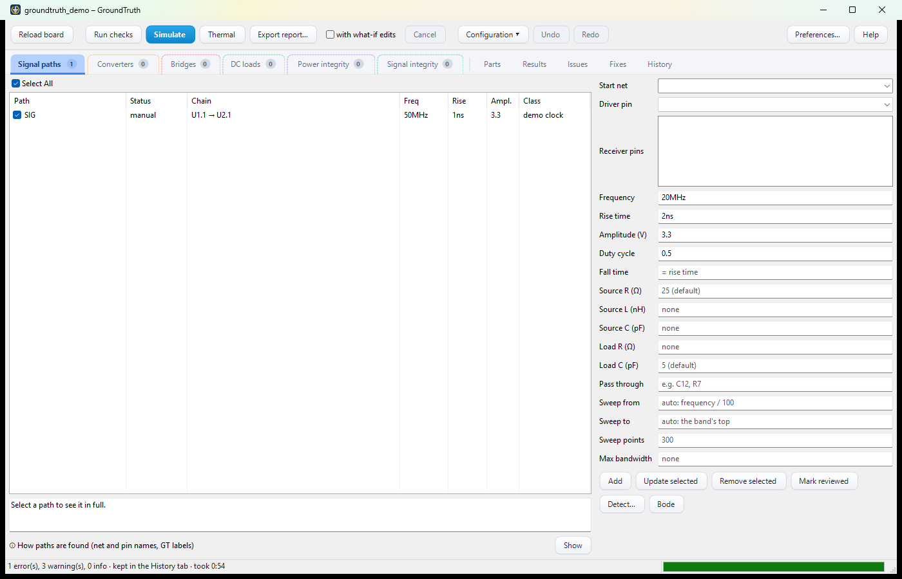
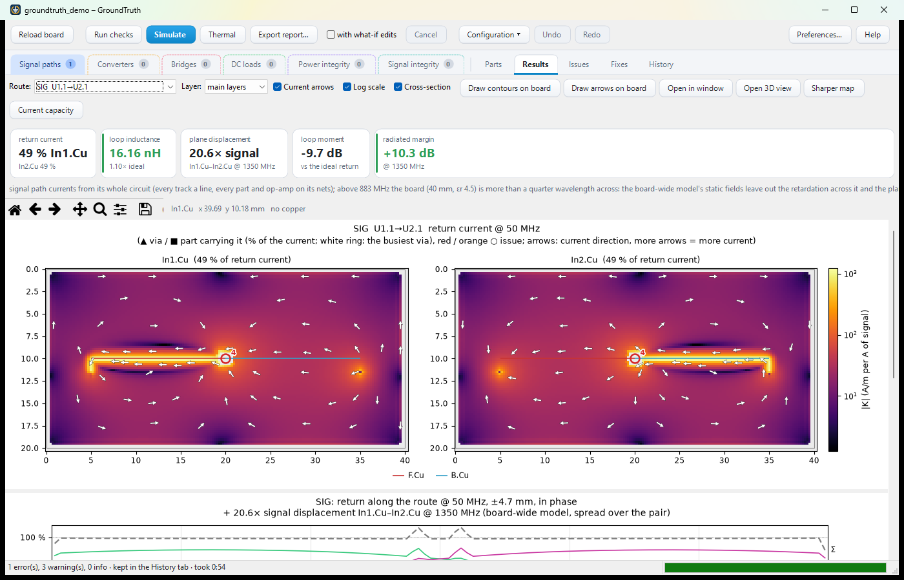
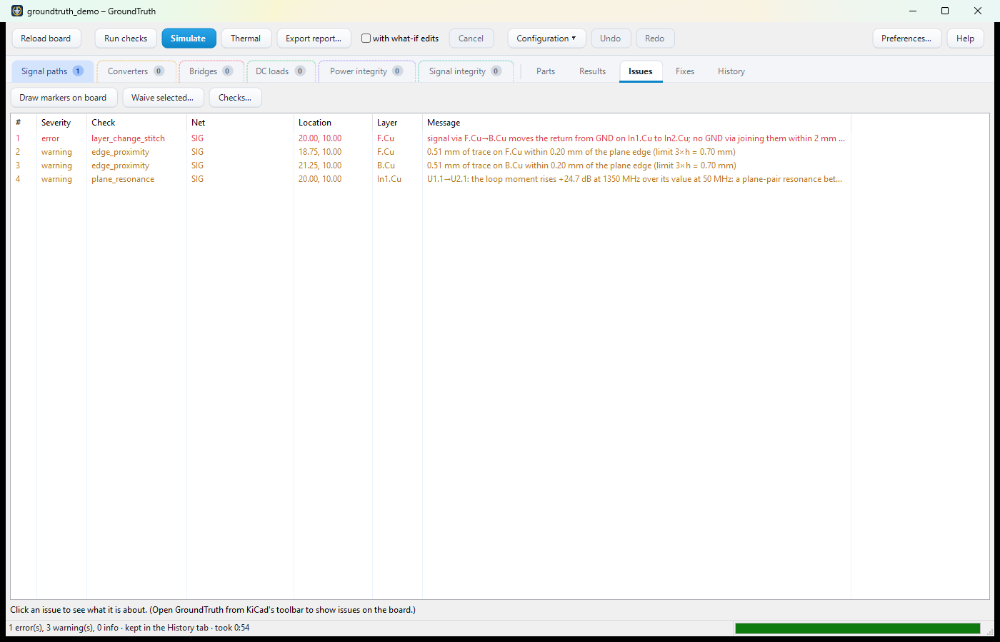

> [!WARNING]
> **Vibe-coded, for illustrative purposes only.** GroundTruth was written largely with an AI assistant. Many of its
> results look reasonable, but they have not all been validated on real hardware: don't base design or compliance
> decisions on them alone.

# GroundTruth — return-path and EMI analysis for KiCad

GroundTruth finds where the return currents of fast signals and switching power stages really flow on a KiCad 10+
board, and what that does to emissions. It flags return-path problems (a trace crossing a plane split, a layer change
with no stitching via, a trace along a plane edge), solves the return current in every plane layer, and estimates how
much each detour adds to radiated and conducted emission, with fixes it checks before suggesting them.

On the same board model it also analyses:

- **DC-DC power stages and motor bridges**: hot loops, capacitor current sharing, switch-node overshoot, conducted
  emission through a LISN, losses, current density, control loops, and what the switching couples into the rest of the
  board ([Power stages](docs/guide/power.md));
- **temperatures**: copper and part temperatures from the currents and losses, and each stage's current capacity
  ([Thermal](docs/guide/power.md#temperatures-thermal-solve));
- **DC loads, power integrity, safety and signal integrity**: the drop each load sees, each IC's supply impedance,
  clearances and part ratings, impedance, skew and crosstalk ([Other analyses](docs/guide/analyses.md)).

It comes as a **KiCad plugin** (the window below, with heatmaps, markers drawn on the board and an HTML report) and
as the **`groundtruth` command line** for CI, which needs neither KiCad nor a display. Both use the same analysis core
and the same settings file, and give the same results.

## The plugin



**Set up.** The coloured tabs are what a run analyses: signal paths, converters, motor bridges, DC loads, power
integrity rails and signal-integrity pairs, each row with a tick box. GroundTruth detects them when a board is opened
(orange until you review them); each tab's badge counts the rows the next run takes. **Run checks** gives the rule
checks in seconds, **Simulate** the field solver in minutes. **Configuration ▾** saves and loads a set-up, **Undo**
takes back a change.



**Results.** The return current in each plane layer as a heatmap with current arrows, the vias that carry it between
layers, a cross-section along the route and the emission spectrum against its limit. **Draw contours / arrows on
board** puts them into KiCad.



**Issues.** Every finding with its severity; a click selects, highlights and zooms to it in KiCad. **Fixes** proposes
stitching vias and capacitors, predicts and verifies them; **History** keeps every Simulate to compare; **Export
report…** writes the results as one HTML page. The plugin's own **Help** (F1) explains each tab.

## Install

**The KiCad plugin.** In KiCad, enable the API (**Preferences → Plugins → Enable KiCad API**, restart KiCad). Then
**Tools → Plugin and Content Manager → Manage… → Add** the repository
`https://afkiwers.github.io/GroundTruth/repository.json`, select it and install **GroundTruth**; new releases show up
as updates. Each [release](https://github.com/afkiwers/GroundTruth/releases) also has the package as a zip for
**Install from File…**. On the first start KiCad builds the plugin's Python environment (a few minutes); the button
**Analyse return paths** then appears in the PCB editor's top toolbar.

**The command line.** Python 3.11 or newer; install a release's wheel (GroundTruth is not on PyPI):

```sh
pip install "groundtruth-pcb @ https://github.com/afkiwers/GroundTruth/releases/download/0.1.42593/groundtruth_pcb-0.1.42593-py3-none-any.whl"
```

More, including the development setup, GPU acceleration and where everything is on disk: [Installing](docs/guide/install.md).

## Quick start

In KiCad: open the board in the PCB editor and click **Analyse return paths**.

1. **Review** what GroundTruth found on the coloured tabs (orange rows): a net's driver and receivers and its timing,
   a converter's switches and operating point, a bridge's motor. Fill in what the board can't tell, press **Mark
   reviewed**.
2. **Run checks**: the rule checks; the Issues tab lists what they find.
3. **Simulate**: the field solver on everything ticked; the Results tab shows the maps and margins.
4. **Fix**: click an issue to see it in KiCad, let **Suggest fixes** propose vias and capacitors, try them as what-if
   edits.

The plugin folder has a demo board to try this on (`demo\README.txt`). On the command line:

```sh
groundtruth init board.kicad_pcb                 # the settings file, with every part's suggested model
groundtruth detect board.kicad_pcb --write       # nets, power stages and motor bridges to analyse (review them)
groundtruth check board.kicad_pcb                # the rule checks (seconds)
groundtruth simulate board.kicad_pcb --format html --out-dir report   # the field solver, an HTML report
```

## Part parameters for your parts database

GroundTruth reads part parameters (a FET's `Rds(on)` and `Coss`, a capacitor's `ESR` and `Cbias`, an op-amp's `GBW`,
a controller's `Vref` …) from the symbols' fields. Add them to the parts in your parts database, and KiCad's HTTP
library interface brings them into the schematic with the parts, where GroundTruth reads them on every run. The full
list, grouped by the tab that uses each (a parameter used on several tabs is listed under each, with where else it is
used): [Part parameters](docs/guide/part-fields.md).

## Documentation

| Guide | What's in it |
|---|---|
| [Installing](docs/guide/install.md) | the plugin and the command line, the development setup, GPU acceleration, where things are |
| [How it works](docs/guide/how-it-works.md) | the analyses, how the solver splits the work, accuracy and what the numbers mean |
| [Part parameters](docs/guide/part-fields.md) | every part parameter GroundTruth reads from the symbols' fields, by tab: to add to your parts database |
| [The settings file](docs/guide/settings.md) | what a board's settings hold, configurations, part models from the schematic, the checks and their severities, finding the nets, GT labels |
| [Working in KiCad](docs/guide/plugin.md) | showing issues on the board, drawing on it, fix suggestions and what-if edits |
| [Power stages and bridges](docs/guide/power.md) | DC-DC converters, motor bridges, victims, control loops, the thermal solve |
| [Other analyses](docs/guide/analyses.md) | op-amp circuits and Bode plots, capacitance at DC bias, DC loads, power integrity, safety checks, signal integrity |
| [The command line](docs/guide/cli.md) | the commands, options and exit codes |
| [CI (GitLab)](docs/guide/ci.md) | checking a board repository in a pipeline, the release gate `groundtruth verify` and its thresholds |
| [Compute server](docs/guide/compute-server.md) | running the heavy analyses on other machines on the network |
| [Status and roadmap](docs/guide/status.md) | what is done and what is planned |
| [Releases](docs/guide/releases.md) | for maintainers: how a release is built, signed and published |

For developers: [Development](docs/guide/development.md) (the source tree), [ARCHITECTURE.md](docs/ARCHITECTURE.md)
(the physics, data flow and design decisions) and [REFERENCES.md](docs/REFERENCES.md) (every source and assumption).
Example boards with their settings: [examples/](examples/README.md).

## License

GroundTruth is free software under the GNU General Public License v3.0: see [LICENSE](LICENSE).
