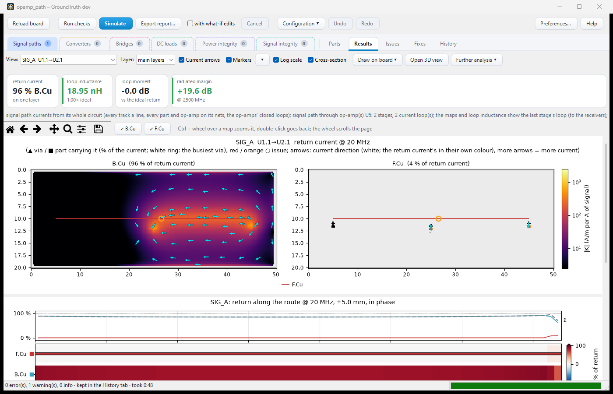
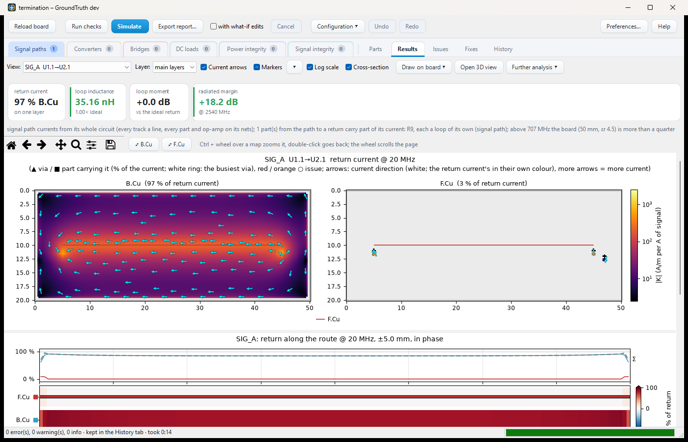
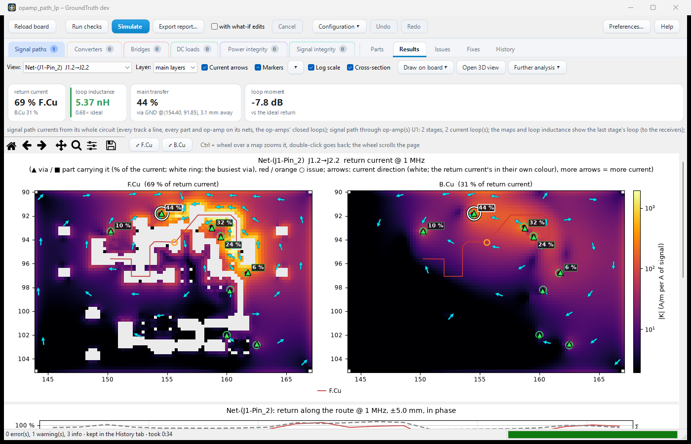

# GroundTruth examples

Small 2-layer boards (50 x 20 mm, a GND plane on B.Cu), one feature each. Open a folder's `.kicad_pro` in KiCad 10,
open its PCB editor and start GroundTruth: the settings file in its `groundtruth/` folder already lists the signal
net, its source and load, and the part models. Or from the command line:

    groundtruth simulate examples/opamp_path/opamp_path.kicad_pcb --format html --out-dir out/

| Folder | Shows |
|---|---|
| `opamp_path/` | A signal path through an op-amp stage: U1 → 33 Ω R1 → op-amp U5 (Gain 10, GBW 10 MHz from its symbol fields) → U2. Two current loops, both returning at U5's GND pin; the report's signal path lists the op-amp with its gain at the worst harmonic. |
| `series_path/` | A signal path across four nets: U1 → 33 Ω R1 → 1 µH L1 → 100 nF C1 (an AC-coupling capacitor, named in the net's Pass through) → U2. Each part's impedance counts at its place; the inductor resonates with the load near 60 MHz and blocks the current above. |
| `rc_filter/` | The series path with a 1 nF capacitor C9 from SIG_B to GND after R1: an RC low-pass. Above its corner (~5 MHz) the current returns through C9: a current loop of its own, shorter than the whole path. |
| `termination/` | The series path with a 50 Ω resistor R9 from SIG_D to GND just beyond the receiver: a parallel termination as a part. It gives what `load_ohms: 50` on the net gives (within 0.5 dB). |
| `opamp_mfb_lowpass/` | A real KiCad project (schematic and board, not generated): TI's OPA376 multiple-feedback low-pass (gain 5, 25 kHz, Chebyshev). Its transfer function read from the board is TI's equation exactly; its own README has the numbers. |
| `gitlab-ci.yml` | A GitLab pipeline: the checks on every merge request, the simulation with its HTML report on main ([CI guide](../docs/guide/ci.md)). |
| `release.gtthresholds.yaml` | The documented thresholds template for `groundtruth verify` (the CI release gate in `gitlab-ci.yml`): every criterion, edit the limits. |

## What Simulate shows

The plugin's Results tab after **Simulate** on each example: the return current in each copper layer as a heatmap
with current arrows, the tiles above it (the layer carrying the return, the loop inductance, the margins) and, below
it, the cross-section of the return along the route.

**`opamp_path/`**: the return in the B.Cu plane follows the track and gathers at the op-amp U5's GND pin, where both current loops close (96 % of the return on B.Cu, 18.95 nH).

**`series_path/`**: one route across four nets, the return spread under the whole track; the loop inductance (35.16 nH) is the ideal return's (1.00x).

**`rc_filter/`**: the same route with C9 to GND after R1; above its corner part of the current returns through C9, a shorter loop of its own (the radiated margin's worst frequency moves down to 220 MHz).

**`termination/`**: the same route with the 50 Ω parallel termination R9 beyond the receiver, carrying the current to GND at the far end.

**`opamp_mfb_lowpass/`**: a real layout at 1 MHz: the return splits 69 % F.Cu / 31 % B.Cu, and the labelled vias show each one's share of it between the layers (44 % through the busiest).

Except `opamp_mfb_lowpass/` (drawn in KiCad, kept as it is), the boards are made by `tools/make_examples.py` from
`tests/boardgen.py` (the boards the tests simulate); the files here are regenerated by it, so edit the generator
rather than the boards. `gitlab-ci.yml` (a GitLab pipeline running the checks and the simulation in CI) and
`release.gtthresholds.yaml` (`groundtruth verify --write-template` writes the same) are kept as they are. The
screenshots in `images/` are taken with `tools/dev/window_shot.py BOARD --settings S --theme light --simulate --tabs
Results`; take them again when a board or the Results tab changes.
